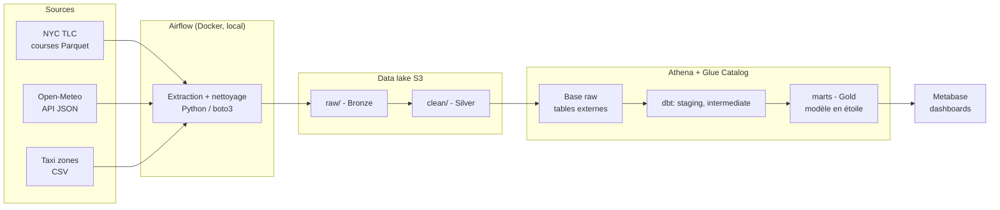
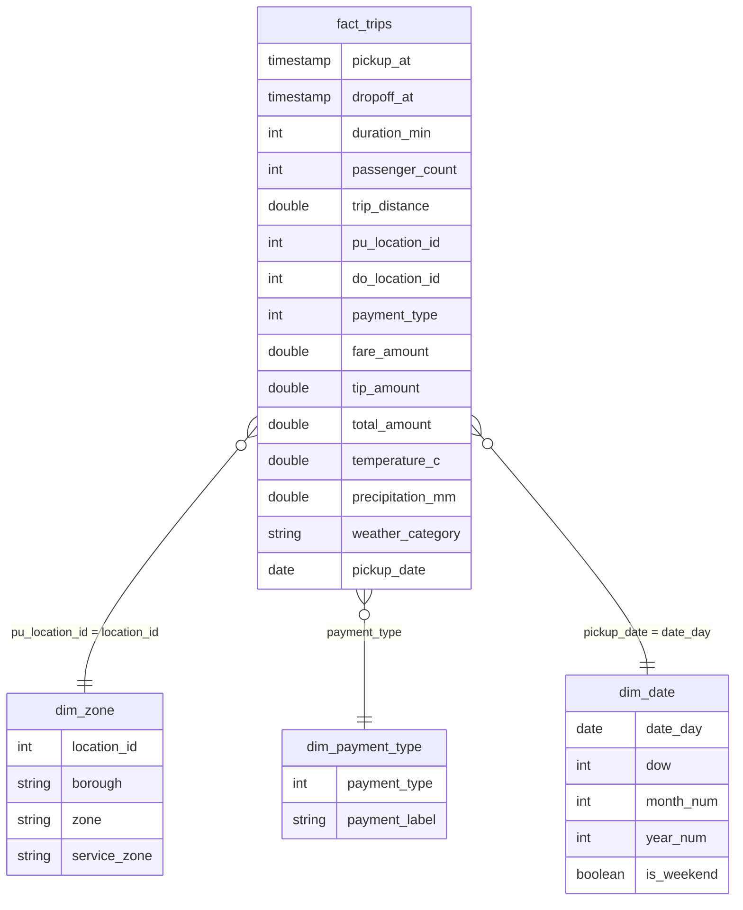
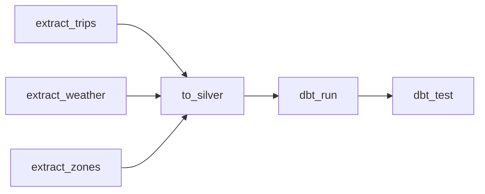

# NYC Urban Mobility Analytics

Pipeline de données **ELT de bout en bout** sur **AWS Free Tier** : ingestion de trois sources publiques (courses de taxi de New York, météo horaire, référentiel des zones), stockage dans un data lake S3, transformation avec **dbt** dans **Athena** (modèle en étoile), orchestration avec **Airflow** et dashboards **Metabase**.

> Projet d'apprentissage en data engineering : toute la stack est gratuite ou utilisée dans les limites du Free Tier AWS.

---

## Sommaire

1. [Objectif](#1-objectif)
2. [Architecture](#2-architecture)
3. [Stack technique](#3-stack-technique)
4. [Sources de données](#4-sources-de-données)
5. [Modèle de données](#5-modèle-de-données)
6. [Pipeline et orchestration](#6-pipeline-et-orchestration)
7. [Qualité des données](#7-qualité-des-données)
8. [Dashboards](#8-dashboards)
9. [Structure du dépôt](#9-structure-du-dépôt)
10. [Lancer le projet](#10-lancer-le-projet)
11. [Coûts et sécurité](#11-coûts-et-sécurité)
12. [Choix techniques](#12-choix-techniques)
13. [Limites et précautions d'analyse](#13-limites-et-précautions-danalyse)
14. [Problèmes rencontrés](#14-problèmes-rencontrés)
15. [Pistes d'amélioration](#15-pistes-damélioration)
16. [Licences et crédits](#16-licences-et-crédits)

---

## 1. Objectif

Construire une plateforme de données qui amène des données brutes dispersées jusqu'à des tableaux de bord lisibles par un public non technique.

Questions métier traitées :

- Comment la météo (pluie, neige, température) influence-t-elle la demande de courses et les pourboires ?
- Quelles zones et quelles heures sont les plus rentables ?
- Comment évoluent le revenu, le panier moyen et les modes de paiement dans le temps ?

Période traitée : **janvier à mars 2025** (environ 3 millions de courses par mois).

---

## 2. Architecture



### Architecture médaillon

| Couche | Emplacement | Contenu | Produite par |
|---|---|---|---|
| **Bronze** | `s3://<bucket>/raw/` | fichiers tels que téléchargés, jamais modifiés | `ingestion/extract.py` |
| **Silver** | `s3://<bucket>/clean/` | Parquet typé, colonnes stables, partitionné par année/mois | `ingestion/to_silver.py` |
| **Gold** | base Glue `marts` | modèle en étoile prêt pour la BI | dbt |

> Remarque de nommage : la base Glue `raw` contient des **tables externes qui pointent vers le dossier S3 `clean/`** (couche Silver). Le nom vient de la convention « première table lisible par dbt ».

### Rôle de chaque service

| Service | Rôle |
|---|---|
| **S3** | stocke les fichiers |
| **Glue Data Catalog** | décrit les fichiers (colonnes, types, emplacement, partitions) |
| **Athena** | exécute le SQL directement sur les fichiers de S3 |
| **dbt** | organise et enchaîne les transformations SQL |
| **Airflow** | lance chaque tâche dans l'ordre, relance en cas d'échec |
| **Metabase** | affiche les graphiques, en interrogeant Athena |

---

## 3. Stack technique

| Couche | Technologie | Licence / coût |
|---|---|---|
| Infrastructure as Code | Terraform | gratuit |
| Conteneurs | Docker, Docker Compose | gratuit |
| Orchestration | Apache Airflow 2.10 | open source |
| Ingestion | Python 3.11 (requests, boto3, pandas, PyArrow) | open source |
| Data lake | Amazon S3 | crédits AWS (quelques centimes) |
| Catalogue | AWS Glue Data Catalog | gratuit dans les limites du Free Tier |
| Moteur SQL / entrepôt | Amazon Athena (Trino) | paiement au volume scanné, plafonné |
| Transformation | dbt Core + dbt-athena-community | open source |
| Qualité | tests dbt + dbt_utils | open source |
| Visualisation | Metabase OSS | open source, local |

---

## 4. Sources de données

| Source | Format | Contenu | Accès |
|---|---|---|---|
| **NYC TLC Trip Records** (yellow taxi) | Parquet mensuel | courses : horodatages, zones, distance, tarif, pourboire, paiement | `https://d37ci6vzurychx.cloudfront.net/trip-data/yellow_tripdata_AAAA-MM.parquet` |
| **Taxi Zone Lookup** | CSV | `LocationID`, borough, zone, service_zone (265 lignes) | `https://d37ci6vzurychx.cloudfront.net/misc/taxi_zone_lookup.csv` |
| **Open-Meteo Historical API** | JSON | température, précipitations, vent, code météo WMO, par heure | `https://archive-api.open-meteo.com/v1/archive` (sans clé) |

Trois formats (Parquet, JSON, CSV), une ingestion en batch mensuel.

---

## 5. Modèle de données

Modèle en étoile dans la base `marts` :



**Grain de `fact_trips` :** une ligne = une course.

### Couches dbt

| Dossier | Modèles | Matérialisation | Rôle |
|---|---|---|---|
| `staging` | `stg_trips`, `stg_weather` | vue | nettoyage : filtres de qualité, durée, catégories météo (`neige`, `pluie`, `sec` à partir des codes WMO) |
| `intermediate` | `int_trips_enriched` | vue | jointures courses + météo (heure arrondie) + zones |
| `marts` | `fact_trips` | incrémentale, partitionnée par `pickup_date`, Parquet | table de faits |
| `marts` | `dim_zone`, `dim_date`, `dim_payment_type` | table | dimensions |

`fact_trips` utilise la stratégie **`insert_overwrite`** : relancer un mois remplace uniquement les partitions de ce mois, sans créer de doublon.

---

## 6. Pipeline et orchestration

Le DAG Airflow `nyc_mobility` s'exécute chaque mois et rattrape l'historique (`catchup=True`) de janvier à mars 2025 :



| Paramètre | Valeur | Raison |
|---|---|---|
| `schedule` | `@monthly` | un run par mois |
| `catchup` | `True`, avec `end_date` | rattrape les 3 mois, pas davantage |
| `max_active_runs` | `1` | un mois à la fois (mémoire du conteneur) |
| `retries` | `2`, espacés de 2 minutes | absorbe les coupures réseau passagères |
| `execution_timeout` | 45 minutes | évite une tâche bloquée indéfiniment |

### Idempotence : relancer ne crée jamais de doublon

| Étape | Mécanisme |
|---|---|
| Extraction | le fichier est ignoré s'il existe déjà dans S3 |
| Silver | le fichier de `clean/` est écrasé (même chemin) |
| `fact_trips` | `insert_overwrite` sur les partitions de dates du mois traité |

### Nettoyage Silver (`to_silver.py`)

- sélection des colonnes utiles et renommage en `snake_case` ;
- types imposés (`int32`, `float64`, `timestamp`), car le schéma des fichiers TLC varie d'un mois à l'autre ;
- exclusion des courses dont la date n'appartient pas au mois du fichier (horloges de taxis déréglées, courses de 2002 ou 2009) ;
- écriture en Parquet partitionné : `clean/trips/year=AAAA/month=MM/`.

---

## 7. Qualité des données

Environ quinze tests, exécutés par `dbt test` à la fin de chaque run :

| Test | Cible | Gravité |
|---|---|---|
| `unique`, `not_null` | clés de `dim_zone`, `dim_date`, `dim_payment_type` | error |
| `not_null` | `pickup_at`, `pickup_date` | error |
| `relationships` | `pu_location_id` vers `dim_zone.location_id` | warn |
| `accepted_values` | `payment_type` entre 0 et 6 | error |
| `expression_is_true` | durée entre 0 et 1440 minutes | error |
| `expression_is_true` | `total_amount >= 0` | warn |
| test singulier | `fact_trips` contient autant de courses que `stg_trips` sur le mois traité | error |
| `unique` | `observed_at` dans `stg_weather` (risque de doublon au changement d'heure) | warn |

Un test en gravité `error` fait échouer la tâche `dbt_test` dans Airflow, donc le run entier.

---

## 8. Dashboards

Trois dashboards Metabase, construits sur les tables `marts` uniquement. Les requêtes SQL de chaque graphique sont dans [`dashboards/queries.sql`](dashboards/queries.sql).

| Dashboard | Contenu |
|---|---|
| **1. Vue exécutive** | courses, revenu, panier moyen, évolution par jour, répartition par mode de paiement |
| **2. Zones** | top 10 des zones de départ par revenu, revenu par borough |
| **3. Impact de la météo** | courses par heure selon la météo, pourboire selon la météo et la température, heatmap heure x jour |

<!-- Remplace les chemins ci-dessous par tes vraies captures -->


### Lineage dbt


### DAG Airflow


---

## 9. Structure du dépôt

```
NYC-Urban-Mobility-Analytics/
├── docker-compose.yml          # Airflow, Postgres, Metabase
├── .env.example                # noms des variables (jamais de valeurs)
├── terraform/                  # bucket S3, bases Glue, workgroup Athena
│   ├── main.tf
│   └── ...
├── airflow/
│   ├── Dockerfile              # image Airflow + dbt dans un venv séparé
│   └── dags/
│       └── nyc_mobility_dag.py
├── ingestion/
│   ├── extract.py              # Bronze : téléchargement vers S3 raw/
│   ├── to_silver.py            # Silver : nettoyage vers S3 clean/
│   └── ddl.sql                 # tables externes Athena
├── dbt_project/
│   ├── dbt_project.yml
│   ├── profiles.yml
│   ├── packages.yml
│   ├── macros/
│   │   └── generate_schema_name.sql
│   ├── models/
│   │   ├── staging/
│   │   ├── intermediate/
│   │   └── marts/
│   └── tests/
├── dashboards/
│   └── queries.sql             # requêtes des graphiques Metabase
├── docs/
│   └── images/                 # captures
└── README.md
```

---

## 10. Lancer le projet

### Prérequis

- Un compte **AWS** (Free plan) avec un utilisateur IAM programmatique (pas le compte root), le MFA activé et un **budget d'alerte** configuré
- [AWS CLI](https://aws.amazon.com/cli/) configurée (`aws configure`, région `eu-west-1`)
- [Terraform](https://developer.hashicorp.com/terraform/install)
- [Docker Desktop](https://www.docker.com/products/docker-desktop/) avec **au moins 4 Go de mémoire** alloués
- Git

### Étapes

**1. Cloner le dépôt et configurer l'environnement**

```bash
git clone https://github.com/TON_COMPTE/NYC-Urban-Mobility-Analytics.git
cd NYC-Urban-Mobility-Analytics
cp .env.example .env
```

Renseigner dans `.env` : `AWS_ACCESS_KEY_ID`, `AWS_SECRET_ACCESS_KEY`, `AWS_DEFAULT_REGION`, `LAKE_BUCKET` (le nom du bucket vient de l'étape suivante).

**2. Créer l'infrastructure AWS**

```bash
cd terraform
terraform init
terraform plan
terraform apply
terraform output -raw bucket     # à recopier dans .env (LAKE_BUCKET)
cd ..
```

**3. Créer les tables Athena**

Dans la console Athena, avec le workgroup `nyc-mobility`, exécuter le contenu de `ingestion/ddl.sql` après avoir remplacé `BUCKET` par le nom du bucket. Ce script ne copie aucune donnée : il crée les fiches des tables dans le catalogue Glue.

**4. Lancer Airflow et Metabase**

```bash
docker compose build
docker compose up airflow-init
docker compose up -d
```

- Airflow : http://localhost:8080
- Metabase : http://localhost:3000

**5. Lancer le pipeline**

Dans Airflow, activer le DAG `nyc_mobility` (bouton de pause). Les trois runs (janvier, février, mars 2025) s'exécutent l'un après l'autre. Durée : 5 à 15 minutes par mois.

**6. Vérifier les résultats**

Dans la console Athena :

```sql
SELECT date_trunc('month', pickup_date) AS mois, count(*) AS courses
FROM marts.fact_trips
GROUP BY 1 ORDER BY 1;
```

Résultat attendu : trois lignes, avec environ 3 millions de courses chacune.

**7. Connecter Metabase**

*Admin settings > Databases > Add database > Amazon Athena* : région `eu-west-1`, workgroup `nyc-mobility`, répertoire de résultats `s3://<bucket>/athena-results/`, et les clés d'un utilisateur IAM en lecture seule. Recréer ensuite les questions à partir de `dashboards/queries.sql`.

### Lancer un seul mois à la main (débogage)

```bash
docker compose exec airflow-scheduler bash
cd /opt/airflow
python -c "
from ingestion.extract import extract_trips, extract_weather, extract_zones
from ingestion import to_silver as s
extract_trips(2025, 1); extract_weather(2025, 1); extract_zones()
s.trips_to_silver(2025, 1); s.weather_to_silver(2025, 1); s.zones_to_silver()
"
cd dbt_project
/home/airflow/dbt_venv/bin/dbt run  --vars '{start_date: 2025-01-01, end_date: 2025-01-31}'
/home/airflow/dbt_venv/bin/dbt test --vars '{start_date: 2025-01-01, end_date: 2025-01-31}'
```

### Tout supprimer

```bash
docker compose down -v
cd terraform && terraform destroy
```

Supprimer ensuite à la main, dans IAM, les utilisateurs et les clés d'accès créés pour le projet (Terraform ne les connaît pas), puis vérifier dans la console AWS qu'aucune ressource ne subsiste.

---

## 11. Coûts et sécurité

### Coûts

Les nouveaux comptes AWS fonctionnent avec des **crédits** (Free plan). Le projet est conçu pour en consommer très peu :

| Poste | Maîtrise |
|---|---|
| S3 | environ 300 Mo de Parquet pour trois mois |
| Glue Data Catalog | gratuit dans les limites du Free Tier (quelques tables) |
| Athena | facturé au volume scanné ; tables en Parquet partitionnées par date |
| Calcul | aucune instance EC2, RDS ni NAT Gateway : Airflow et Metabase tournent en local |

Garde-fous :

- le workgroup Athena **plafonne chaque requête à 5 Go scannés** (`bytes_scanned_cutoff_per_query`) ;
- les résultats Athena expirent après 7 jours ;
- les données sont limitées à trois mois ;
- toute requête Metabase filtre sur la colonne de partition `pickup_date` ;
- un budget d'alerte AWS est configuré ;
- `terraform destroy` supprime l'ensemble de l'infrastructure.

### Sécurité

- Bucket S3 privé, accès public bloqué
- Aucun secret dans le dépôt : identifiants dans `.env`, exclu par `.gitignore`
- Utilisateur IAM de lecture seule pour Metabase
- Pas d'utilisation du compte root

---

## 12. Choix techniques

| Choix | Raison |
|---|---|
| **ELT plutôt qu'ETL** | le gros du calcul (jointures sur des millions de lignes) se fait dans le moteur SQL, pas en Python ; Python ne fait qu'un nettoyage léger |
| **Athena comme entrepôt** | serverless, sans abonnement ni cluster à payer à l'heure, compatible dbt, très répandu en entreprise (lakehouse S3 + Glue) |
| **Parquet partitionné par mois** | format colonnaire compressé ; Athena ne lit que les colonnes et les dossiers utiles, donc moins de données scannées et moins de coût |
| **Trois couches (Bronze, Silver, Gold)** | le brut reste intact : on peut tout rejouer en cas d'erreur de nettoyage |
| **Projection de partitions** | les nouveaux mois sont visibles sans commande de maintenance (`MSCK REPAIR`) |
| **`insert_overwrite` dans dbt** | relancer un mois ne crée pas de doublon |
| **dbt dans un venv séparé** | évite les conflits de dépendances avec Airflow |
| **Airflow et Metabase en local** | zéro coût de calcul |
| **Terraform** | infrastructure reproductible : tout se recrée ou se supprime en une commande |

---

## 13. Limites et précautions d'analyse

- **Trois mois d'hiver seulement** : peu de temps chaud et peu de neige. Les conclusions sur la météo ne se généralisent pas à l'année.
- **Pourboires en espèces non enregistrés** : ils valent 0 dans les données de la TLC. Les analyses de pourboire ne portent que sur les paiements par **carte** (`payment_type = 1`).
- **Comparer des courses par catégorie météo sans normaliser est trompeur** : il y a bien plus d'heures « sec » que d'heures « neige ». Les graphiques comparent donc des **courses par heure**.
- **Valeurs manquantes** : lors du nettoyage, un `passenger_count` ou un numéro de zone manquant devient `0`. Une zone `0` n'existe pas dans le référentiel : le test `relationships` la signale (en avertissement).
- **Jointure météo à l'heure** : la météo d'une course est celle de l'heure pleine de sa prise en charge. Au changement d'heure d'automne, une heure se répète ; un test signale les doublons éventuels.
- **Un seul point de mesure météo** pour toute la ville.
- **Athena n'est pas un entrepôt MPP classique** (type Redshift ou Snowflake) : le choix est discuté plus haut.
- **Publication des données de la TLC avec environ deux mois de retard** : en production, le DAG devrait traiter le mois courant moins deux.

---

## 14. Problèmes rencontrés

| Problème | Cause | Solution |
|---|---|---|
| `NoSuchKey` dans `to_silver.py` | le nom du fichier météo lu (`weather_2025_01.json`) ne correspondait pas à celui écrit par l'extraction (`weather_2025-01.json`) | aligner les deux noms ; idée : centraliser les chemins dans un seul module |
| `to_silver` très long ou tué par Docker | lecture complète d'un fichier de 3 millions de lignes avec peu de mémoire | allouer 4 Go minimum à Docker ; lire uniquement les 12 colonnes utiles |
| `dim_zone` créée dans `staging` au lieu de `marts` | `config(schema='marts')` absent du modèle | corriger le fichier, relancer, supprimer l'ancienne table |
| Un mois manquant dans `fact_trips` | le run de ce mois a échoué sur `dbt_run`, mais Airflow a quand même lancé le mois suivant | lire les logs de la tâche, corriger, puis `Clear` de la tâche en échec |
| Page de connexion Metabase au premier lancement | un compte admin existait déjà dans le volume | recréer le volume `mbdata` |
| `TOO_MANY_OPEN_PARTITIONS` (risque) | Athena limite à 100 partitions écrites par requête | traiter un mois à la fois ; `force_batch=true` si besoin |

---

## 15. Pistes d'amélioration

- [ ] **CI/CD** avec GitHub Actions : `ruff`, `pytest`, `terraform validate`, `dbt parse`
- [ ] Tests unitaires de `clean_trips` (séparer le calcul de l'accès à S3)
- [ ] Centraliser les chemins S3 dans un module unique
- [ ] SCD Type 2 sur `dim_zone` avec les snapshots dbt
- [ ] Tables **Apache Iceberg** dans Athena (`MERGE`, time travel)
- [ ] Alertes Slack ou e-mail en cas d'échec de tâche
- [ ] Validation avant publication : construire dans un schéma temporaire, tester, puis publier
- [ ] Observabilité des données avec Elementary
- [ ] Streaming : générateur d'événements, Kafka, micro-batchs vers S3
- [ ] Prévision de la demande par zone et par heure (scikit-learn, MLflow)
- [ ] Variante 100 % locale sans compte AWS : MinIO et DuckDB (`dbt-duckdb`)

---

## 16. Licences et crédits

- **Données de courses et zones** : NYC Taxi & Limousine Commission (TLC), données ouvertes de la ville de New York.
- **Données météo** : [Open-Meteo.com](https://open-meteo.com/), sous licence [CC BY 4.0](https://creativecommons.org/licenses/by/4.0/) (usage non commercial).
- Les outils utilisés (Airflow, dbt Core, Metabase, Terraform, Docker) sont employés selon leurs licences respectives.
- Code du projet : licence MIT (ajouter un fichier `LICENSE`).

---

## Auteur

**TON_NOM** : [GitHub](https://github.com/TON_COMPTE) · [LinkedIn](https://www.linkedin.com/in/TON_PROFIL)
